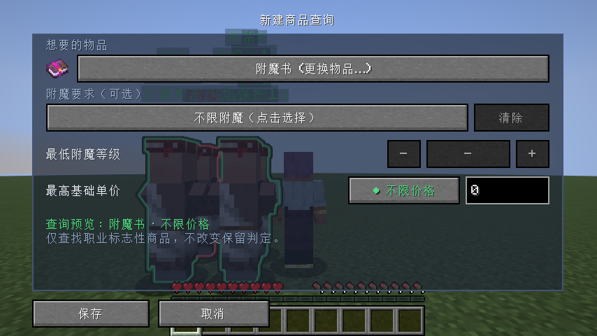
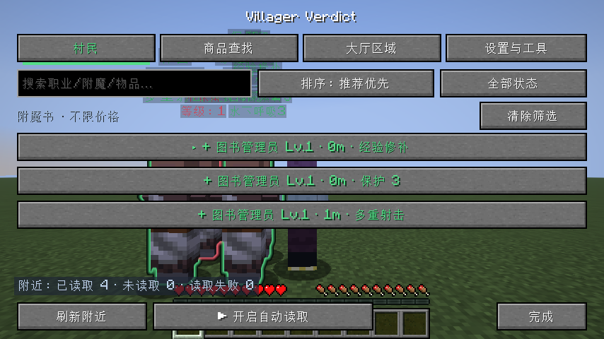
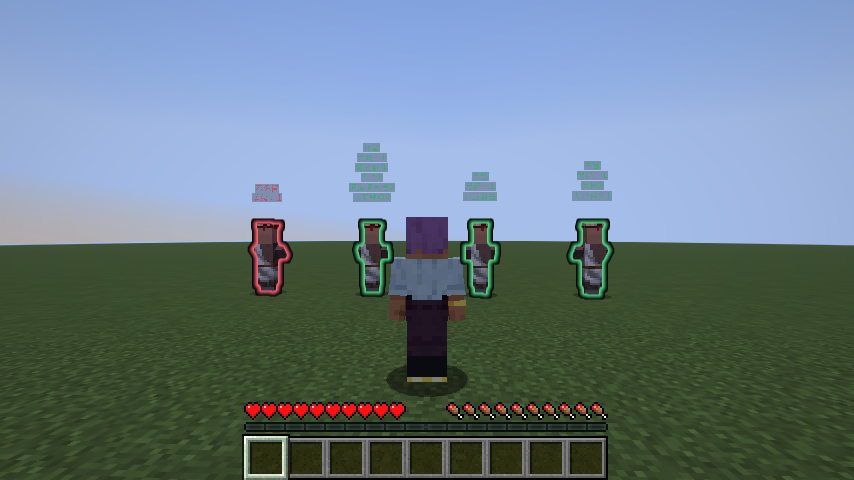
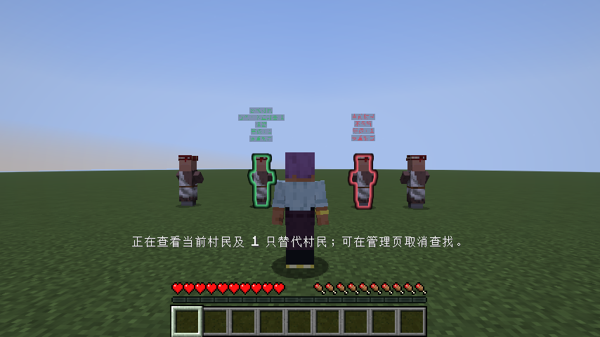

# 职业标志性商品、替代关系与商品查找

验证日期：2026-11-09。使用 Java 25、Minecraft 26.3 和隔离的 Gradle 客户端测试目录；没有修改 PrismLauncher 实例。

## 最终行为

- 保留分析先按职业分组，只使用 `ProfessionHighlights` 定义的标志性交易。纸张、玻璃、书架等普通交易保留在详情里，不参与图书管理员的保留或替代判定。
- 附魔种类必须一致；同种附魔按现有等级优先、同等级比较基础成本的规则处理。独有标志性商品保留来源，统一备份数量继续生效。
- 已扫描但没有标志性商品时判为不保留，详情显示明确原因；未扫描保持黄色，手动锁定保留优先。
- 商品查询只用于结果筛选和提醒，支持物品、附魔、最低等级和基础单价条件；全局和区域查询均不改变保留集合。移除了单条查询的备份数量字段，没有增加旧格式迁移。
- 替代高亮注明具体商品；管理页替代说明同时显示原商品和替代商品。附魔书没有三本或四本数量限制。

## 验证命令

```sh
JAVA_HOME=/Users/eric/.sdkman/candidates/java/25.0.5.0+8-zulu ./gradlew test runClientGameTest build --console=plain
```

结果：79 个 JUnit 测试通过（0 失败、0 跳过），完整客户端集成测试及构建成功。

- [完整集成和构建日志](signature-products-integration.log)
- [标志性商品分析单元测试报告](TEST-cn.ericcraft.villagerverdict.SignatureAnalysisTest.xml)
- [替代选择单元测试报告](TEST-cn.ericcraft.villagerverdict.ReplacementSelectionTest.xml)

## 场景与截图

| 场景 | 验证方式 |
| --- | --- |
| 保护 III、火焰保护与多重射击村民共享纸张/玻璃，不能因普通交易互为替代 | 单元与真实服务器交易包；多重射击独有时保持绿色 |
| 加入更便宜的多重射击来源后，只高亮真实来源，并注明具体替代附魔 | 单元与真实交易页按钮、轮廓和标签断言 |
| 四本不同附魔书完整采集、显示；第四本独有时保留；五本书完整生成联合替代解释 | 四本真实交易包与头顶行数断言，四本及五本单元测试 |
| 工具匠与武器匠隔离，盔甲匠排除铁装备，工具和武器按钻石种类筛选 | 单元测试 |
| 普通交易价格不影响保留候选顺序，备份按不同村民计数 | 单元测试 |
| 商品查询新建、编辑、删除不改变保留结论 | 真实客户端 UI CRUD 和完整分析结果比较 |
| 附魔、基础价格、区域查询及清除筛选 | 实际结果列表断言；折扣价不用于基础价格筛选另有单元测试 |
| 取消查找、切换商人、窗口缩放、标记总开关、判定更新、目标卸载 | 原替代查找客户端回归 |









测试不会修改玩家存档或实例中的模组文件。发布 JAR 为 `build/libs/VillagerVerdict-1.0.0.jar`。
